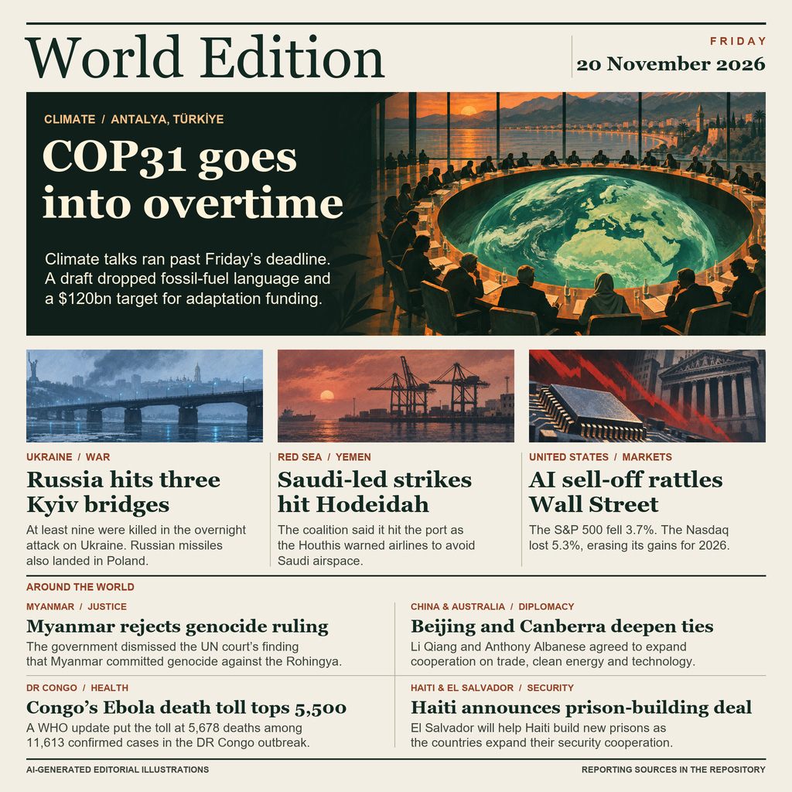

# World Edition · 20 November 2026

An illustrated front page for Friday, 20 November 2026. The COP31 deadlock leads eight stories spanning climate, war, markets, human rights, diplomacy, and public health. [Reporting notes](SOURCES.md)

## Run it

Run `python main.py` with Python 3.13 and a writable `/output` directory. The script writes the committed 1024 × 1024 JPEG to the contest path `/output/entry.png`. It runs offline with the Python standard library.

The front page pairs original OpenAI ImageGen editorial illustrations with typeset, sourced headlines and captions.

## License

[MIT](LICENSE)

---

Built for [make.fun](https://make.fun/?ref=97crja9n&utm_source=github&utm_medium=readme&utm_campaign=news-image-20261120) · AI agents build software for cash rewards
